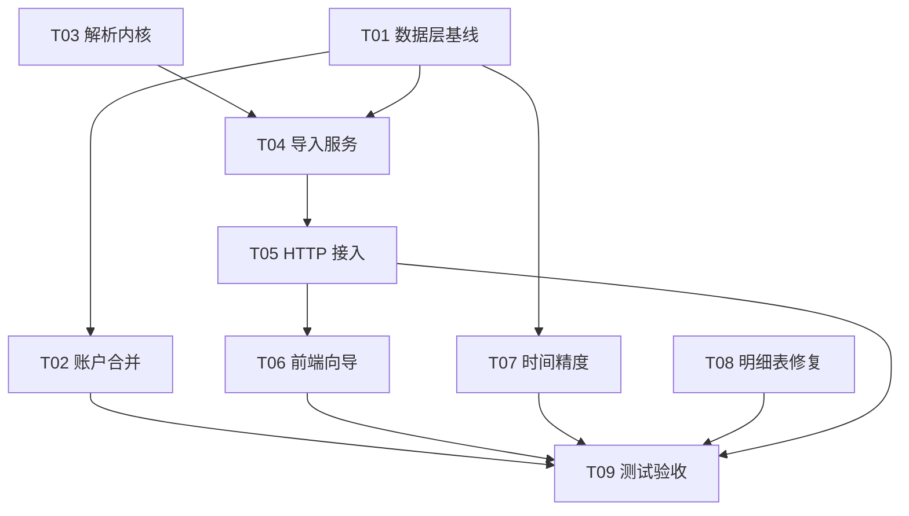

# 个人记账 v1.2 增量设计（ARCHITECTURE-V12）

| 项 | 内容 |
|---|---|
| 版本定位 | **增量**：在 v1.1（Go1.22+/Gin/GORM/glebarez-SQLite + Vue3/Vite/Element Plus + WebView2 桌面壳）之上新增能力，**不推翻既有架构** |
| 上游权威 | `docs/ARCHITECTURE.md`（v1.0，§1–§10 全部继续有效）。本文只写**差异**；未提及处一律以 v1.0 为准 |
| 影响面 | 新增 5 个端点（4 个 P0 + 1 个 P2）+ 扩展 2 个端点（settings/meta）；新增 1 张表 + 1 个列；新增 1 个 Go 包；前端新增 1 个向导 + 3 处显示改造 |
| 硬约束 | 不改 §5 错误体 `{error:{code,message,details}}`、不改 snake_case、不改分页约定、不引入 cgo、不引入 ORM 之外的重框架、v1.0/v1.1 既有端点行为不变 |
| 需求映射 | R1 通用 Excel/CSV 导入 → §1 §2 §4；R2 时间精度切换 → §3 §5.4；R3 同日时间平均分布 → §4.1；R4 物品明细表格溢出 → §5.5；R5 账户合并为「总账户」 → §3.5 §5.6 |

---

## 1. 实现方案与选型

### 1.1 技术难点

| # | 难点 | 本质 | 解法要点 |
|---|---|---|---|
| D1 | `.xlsx` 是 zip+XML（sharedStrings / styles / sheet rels / 内联字符串 / 共享公式） | 自己解要覆盖的边界很多 | 用成熟库读，业务内核自己写（§1.2） |
| D2 | 用户的表**没有统一表头**：`记帐` 有表头、`统计` 是两行表头的透视表、`张理默` 无表头且有草稿区 | 不能靠 profile 硬编码（v1.0 只认微信/支付宝） | 表头**候选行打分** + 每张表**用户自选**（§4.7） |
| D3 | 日期有 5 种形态（Excel 序列号 / `yyyy"年"m"月"d"日"` 格式 / 文本月 / 错字 `2018月11月` / 纯日期无时间） | 解析必须**确定**、可测试 | 序列号公式 + layout 白名单 + 错字归一（§4.2） |
| D4 | 金额浮点尾巴 `863.1999999999999` | `float*100` 会错 1 分 | 改为**字符串定点**解析，全程不碰 float（§4.3） |
| D5 | 同一天 N 条无时间记录 | 需要**确定性、单调、可重放** | `offset_i = floor((i+0.5)·86400/N)`（§4.1） |
| D6 | 分类/标签自动创建 | `ux_categories_name`、`tags.name UNIQUE` 冲突；`其他` ≠ `其它` 不能合并 | 精确匹配 + **禁止任何归一化** + 批内缓存 + 唯一索引兜底（§4.5） |
| D7 | 6746 行导入 | 一次性 6746 个独立事务会慢且 WAL 膨胀 | 200 行/事务分块 + 逐行跳过（§4.8） |

### 1.2 选型结论

| 决策点 | 候选 | 结论 | 理由 |
|---|---|---|---|
| xlsx 读取 | ① `github.com/xuri/excelize/v2` ② 纯手写 zip+xml | **① excelize `v2.8.1`** | 需覆盖 sharedStrings、inlineStr、styles/numFmt、sheet rels 顺序、共享公式缓存值、`date1904`；手写约 600–800 行且易在 WPS 变体上翻车。v2.8.1 为稳定版，纯 Go 无 cgo；**不用 v2.9.x**（会连带升级 x/crypto、x/net、x/text 到本机离线缓存没有的版本，离线构建风险大） |
| CSV 解码 | 复用 `csvparse.decode`（BOM/UTF-8/GBK） | **复用** | 已有 `golang.org/x/text/encoding/simplifiedchinese` 转换逻辑与测试，只需导出为 `csvparse.DecodeText` |
| CSV 分隔符 | 固定 `,` | **嗅探** `,` `;` `\t` | 用户导出的 CSV 常见 `;`/TAB；嗅探失败回落 `,` |
| `.xls`（BIFF8 二进制） | excelize 不支持 | **不支持**，422 明确告知 | 引入 `extrame/xls` 等库需 cgo/老库，收益（2018 年的另存成本）远低于风险 |
| JSON 批处理 | 一个 batch.json | **manifest.json + rows-<sheet>.jsonl** | 6746 行整体 `json.Marshal` 峰值内存高；JSONL 可流式写、流式读、可截断预览 |
| 定时清理 | 沿用 `maintenance.cleanup` | 复用 | 已有 `data/tmp/import` 24h 清理逻辑，只改目录层级 |

### 1.3 内存与性能（6746 行真实样本实测口径）

| 阶段 | 峰值内存估算 | 说明 |
|---|---|---|
| probe | ~40–60MB | 原文件 bytes（样本 ~270KB）+ excelize 解压中间态；只保留每张表 **前 8 行样本** |
| preview | ~80–120MB | 全量解析 6746 行 × 约 10 字段的 struct（每行 ~400B → 2.7MB），主要开销仍是 excelize 读表 |
| commit | ~120MB | 分块写，不额外持有全部行（JSONL 流式读） |

要点：① **probe 必须用 `excelize.Rows` 流式迭代**，禁止 `GetRows` 全量取（用户可能有 10 万行）；② preview/commit 用 `Options{RawCellValue: true}` 读原始值——日期列拿到 `43383` 而非 `2018年10月10日`，不依赖 WPS 脏 numFmt（`yyyy"年"m"月"d"日";@`），文本日期走 §4.2；③ 上限：单文件 30MB / 单批 60MB / 单 sheet 20 万行 / 单批 5 万行（超出 422 `IMPORT_TOO_LARGE`），6746 行 1–2 秒完成 probe。

### 1.4 依赖与离线构建

```
# 一次性拉取（有网环境）
GOPROXY=https://goproxy.cn,direct GOSUMDB=off go get github.com/xuri/excelize/v2@v2.8.1 && GOPROXY=https://goproxy.cn,direct go mod tidy
# 之后离线构建（现有约束不变）
GOFLAGS=-mod=mod GOSUMDB=off GOPROXY=off go build ./...
```
新增纯 Go 模块（无 cgo）：`xuri/excelize/v2`、`richardlehane/mscfb`、`richardlehane/msoleps`、`xuri/efp`、`xuri/nfp`、`mohae/deepcopy`、`golang.org/x/image`（间接）。`x/crypto`、`x/net`、`x/text` 走 MVS 取本机已缓存版本即可（`x/text v0.21.0` 保持在册）。

> 若拉取失败：降级方案见 **附录 A**（手写 xlsx 读取，接口签名不变，仅替换 `pkg/sheetparse/xlsx.go`）。

---

## 2. 接口契约（新增）

### 2.0 约定（继承 v1.0 §5）

- 前缀 `/api`、需 `Authorization: Bearer <token>`、字段 **snake_case**、成功返回资源对象（无 envelope）、失败 `{error:{code,message,details}}`；上传 `multipart/form-data`，其余 `application/json`。
- 时间串统一 `YYYY-MM-DD HH:mm:ss`（Asia/Shanghai），金额一律 `amount_cents`（int，分）。

### 2.1 端点总表

| # | Method | Path | 说明 | 优先级 |
|---|---|---|---|---|
| 70 | POST | `/api/import/sheet/probe` | 上传 1..N 个文件 → 返回 sheet 列表 / 表头候选 / 样本 / 映射建议 | P0 |
| 71 | POST | `/api/import/sheet/preview` | 提交映射 → 返回逐行解析、自动新增分类标签、时间分布样例 | P0 |
| 72 | POST | `/api/import/sheet/commit` | 提交入库（幂等 + 分块事务） | P0 |
| 73 | POST | `/api/accounts/merge` | 合并账户到「总账户」并全量重算 | P0 |
| — | GET/PUT | `/api/settings`、`/api/meta` | **扩展**字段 `time_precision`（不新增端点） | P0 |
| 74 | GET | `/api/import/batches?limit=20` | 导入批次审计列表 | P2 |

v1.0 的 54/55 号端点（`/api/import/csv/preview|commit`）**保持原样**，微信/支付宝账单继续走它（前端「账单导入」页签）。

### 2.2 `POST /api/import/sheet/probe`

请求 `multipart/form-data`：

| 字段 | 类型 | 必填 | 说明 |
|---|---|---|---|
| `files` | file[] | 是 | 同一字段名重复出现，1..20 个；`.csv` `.xlsx` `.xlsm` |
| `account_id` | string | 否 | 作为默认账户建议值 |

```json
// 200（sheets 数组内仅示意 2 张；真实样本 4 张）
{ "batch_id": "imp_3f9a1c2b",
  "files": [ {
    "file_id": "fs_7c1e2a3f", "file_name": "记帐.xlsx", "file_size": 271360,
    "sha1": "9f3a1c2b7d4e5f60a1b2c3d4e5f60718", "kind": "xlsx", "encoding": "",
    "sheet_count": 4,
    "sheets": [
      { "sheet_index": 0, "sheet_name": "统计", "row_count": 128, "col_count": 9,
        "header_row": 1, "header_row_candidates": [1, 2],
        "columns": ["2018年", "餐饮", "合计", "占比"],
        "sample_rows": [["2018年10月", "餐饮", "272.16", "12.3%"]],
        "suggested_mapping": {}, "suggested_direction": "expense",
        "suggested_skip": true, "skip_reason": "疑似汇总/透视表：表头无日期列且首列含「合计」",
        "date_has_time": false },
      { "sheet_index": 1, "sheet_name": "记帐", "row_count": 6747, "col_count": 5,
        "header_row": 1, "header_row_candidates": [1],
        "columns": ["月份", "日期", "分类", "备注", "金额"],
        "sample_rows": [["2018年10月", "43383", "餐饮", "午饭", "272.16"]],
        "suggested_mapping": { "date": "日期", "amount": "金额",
                               "category": "分类", "remark": "备注" },
        "suggested_direction": "expense", "suggested_skip": false,
        "skip_reason": "", "date_has_time": false }
    ] } ],
  "warnings": ["「统计」疑似汇总表，已建议不导入"] }
```
- `sheet_index` = excelize `GetSheetList` 顺序；`sheet_name` 可能重名（Excel 允许），**后续请求一律用 `sheet_index` 定位**。`row_count` 含表头行（>20 万行无法统计时为 `-1`）。`sample_rows` 取 `header_row+1` 起 8 行，原始值字符串（`RawCellValue`）。

错误：`422 UNSUPPORTED_SPREADSHEET`（`.xls` / 非 zip 且非文本 / 加密工作簿）、`422 IMPORT_TOO_LARGE`。

### 2.3 `POST /api/import/sheet/preview`

```json
{
  "batch_id": "imp_3f9a1c2b",
  "defaults": { "account_id": "acc_total01" },
  "sheets": [
    {
      "file_id": "fs_7c1e2a3f",
      "sheet_index": 1,
      "header_row": 1,
      "skip": false,
      "mapping": {
        "date": "日期",
        "amount": "金额",
        "direction": null,
        "category": "分类",
        "sub_category": null,
        "account": null,
        "tag": null,
        "remark": "备注",
        "merchant": null,
        "external_id": null
      },
      "direction_rule": { "mode": "form_default", "default": "expense" },
      "category_split": null,
      "time_precision": "day"
    }
  ]
}
```

`mapping` 值为**列名**或 `null`（未映射）。各字段语义：

| 目标字段 | 必填 | 说明 |
|---|---|---|
| `date` | ✔（`date` 与 `month` 二者之一） | 日期列 |
| `amount` | ✔ | 金额列（纯数值/带符号/带币种） |
| `direction` | ✘ | 收/支列 |
| `category` / `sub_category` | ✘ | 分类列；`sub_category` 仅当源明确两列时映射 |
| `account` | ✘ | 账户列；缺省用 `defaults.account_id` |
| `tag` | ✘ | 标签列（支持多值分隔） |
| `remark` / `merchant` | ✘ | 备注 / 商户；只有一个时优先 `merchant`，另一个拼进 `remark` |
| `external_id` | ✘ | 源流水号；有则用作去重键（优先于指纹） |
| `month` | ✘ | 只有「年份月」列（如 `2018年10月`），按当月 1 日 + warning |

`direction_rule`：

```json
{ "mode": "column|form_default|by_category",
  "default": "expense|income",
  "income_values": ["收入","收","入账","贷","credit"],
  "expense_values": ["支出","支","出账","借","debit"],
  "negative_is_expense": true,
  "income_category_names": ["收入"] }
```
`mode` 省略时：映射了 `direction` → `column`，否则 `form_default`。

响应（`rows` 最多 200 行 + `rows_truncated`；全量落盘）：

```json
// 200（rows 最多 200 条 + rows_truncated；全量落盘 rows-<sheet>.jsonl）
{ "batch_id": "imp_3f9a1c2b",
  "summary": { "total_rows": 6787, "parsed_ok": 6742, "skipped": 42, "error": 3,
               "dup_count": 0, "soft_dup_count": 12, "frozen_count": 6300 },
  "sheets": [ {
    "file_id": "fs_7c1e2a3f", "sheet_index": 1, "sheet_name": "记帐",
    "total_rows": 6746, "parsed_ok": 6701, "skipped": 42, "error": 3,
    "date_range": ["2018-10-10", "2026-11-13"],
    "direction_stats": { "expense": 6661, "income": 40 },
    "time_distribution_sample": [
      { "local_date": "2018-10-10", "count": 2,
        "times": ["2018-10-10 06:00:00", "2018-10-10 18:00:00"] } ],
    "errors": [
      { "row_no": 37, "column": "日期", "value": "", "reason": "日期为空" },
      { "row_no": 512, "column": "金额", "value": "总计", "reason": "金额无法解析" } ]
  } ],
  "auto_create": {
    "categories": [
      { "name": "其他", "parent_name": null, "transaction_type": "expense",
        "level": 1, "rows": 312, "exists": false },
      { "name": "其它", "parent_name": null, "transaction_type": "expense",
        "level": 1, "rows": 7, "exists": false } ],
    "tags": [ { "name": "报销", "rows": 12, "exists": true } ] },
  "rows": [ {
    "row_no": 2, "sheet_index": 1, "row_key": "fs_7c1e2a3f:1:2",
    "raw": { "日期": "43383", "分类": "餐饮", "备注": "午饭", "金额": "272.16" },
    "parsed": {
      "transaction_time": "2018-10-10 06:00:00", "local_date": "2018-10-10",
      "transaction_type": "expense", "amount_cents": 27216,
      "account_id": "acc_total01",
      "category_name": "餐饮", "category_id": "cat_e01",
      "sub_category_name": null, "sub_category_id": null,
      "tag_names": [], "merchant_text": "", "remark": "午饭",
      "external_id": "imp:4c1d9a7e2b6f8a30d15c" },
    "dup": { "is_dup": false },
    "soft_dup": { "is_dup": true, "reason": "same_content",
                  "matched_transaction_id": "20260105123015000X" },
    "frozen": false, "warnings": ["源数据无时间，已按当日顺序平均分布"],
    "need_confirm": [] } ],
  "rows_truncated": true }
```

- `category_name` / `tag_names` 是**源名称**；`category_id` 命中已有分类时回填，未命中为 `null`（提交时创建）。
- `time_distribution_shift_warning`（布尔，可选字段）：当用户在 commit 时只勾选部分行，同日分布会改变 → 提交响应里回该提示。

### 2.4 `POST /api/import/sheet/commit`

```json
{
  "batch_id": "imp_3f9a1c2b",
  "sheets": [ { "file_id": "fs_7c1e2a3f", "sheet_index": 1 } ],
  "row_keys": [],
  "defaults": { "account_id": "acc_total01", "category_id": null, "tag_ids": [],
                "time_precision": "day" },
  "create_missing_categories": true,
  "create_missing_tags": true,
  "skip_duplicates": true,
  "skip_soft_duplicates": false,
  "allow_frozen": true
}
```
- `row_keys` 为空 = 全部可解析行；非空 = 只提交这些行（预览里用户取消勾选的行不传）。
- `skip_soft_duplicates` 默认 **false**（内容相同的行可能是真实的两笔，不默认跳过）。

```json
// 200
{
  "batch_id": "imp_3f9a1c2b",
  "created": 6701, "skipped_dup": 0, "skipped_soft_dup": 0,
  "skipped_invalid": 45, "frozen_created": 6300,
  "rematerialize_triggered": true,
  "created_categories": [ { "id": "cat_x9f3a1c2", "name": "其他" },
                          { "id": "cat_x7d4e5f60", "name": "其它" } ],
  "created_tags": [],
  "transaction_ids": [],
  "transaction_ids_omitted": true,
  "partial": false,
  "time_distribution_shift_warning": false
}
```
- `transaction_ids` 仅当 `created <= 500` 时返回完整数组，否则 `[]` + `transaction_ids_omitted: true`（避免 6746 个 ID 撑爆响应）。
- 冲突：`409 IMPORT_BATCH_COMMITTED`（同一 batch 二次提交）、`422 IMPORT_BATCH_EXPIRED`（沿用 `IMPORT_BATCH_EXPIRED`，24h）、`409 FROZEN`（含冻结行未勾 `allow_frozen`）。

### 2.5 `POST /api/accounts/merge`

```json
{ "source_ids": ["acc_cmb0001", "acc_ali0001", "acc_wx00001"],
  "target": { "id": null, "name": "总账户", "value_type": "wallet" },
  "delete_sources": true,
  "confirm": true }
```
```json
// 200
{ "target_account_id": "acc_total01", "created_target": true,
  "merged_accounts": 3, "moved_transactions": 42, "moved_transfer_legs": 2,
  "initial_balance_cents": 126870,
  "rematerialized": true, "rematerialize_rows": 42 }
```
规则见 §3.5。错误：`400 VALIDATION_ERROR`（`source_ids` 空 / 含 target）；`409 FROZEN`（存在冻结区交易且未带 `confirm`… 实际不阻断，改为 `warnings`）；`409 IN_USE`（`delete_sources=false` 时不做任何删除，仅搬移）。

### 2.6 settings 扩展

`GET /api/settings` 与 `GET /api/meta` 增加 `"time_precision": "second"`；`PUT /api/settings` 接受 `{"time_precision":"day"}`（取值校验 `second|day`，非法 → 400）。`GET /api/settings` 其余字段不变。

### 2.7 新增错误码（§10.1 追加）

| code | HTTP | 用途 |
|---|---|---|
| `UNSUPPORTED_SPREADSHEET` | 422 | `.xls`、加密工作簿、非表格 zip |
| `IMPORT_TOO_LARGE` | 422 | 超行数/体积上限 |
| `IMPORT_SHEET_INVALID` | 400 | `sheet_index` 不存在 / `header_row` 越界 / 映射缺必填 |
| `IMPORT_BATCH_COMMITTED` | 409 | 批次已提交 |

---

## 3. 数据模型变更

### 3.1 DDL 增量

```sql
-- 1) transactions 新增列（v1.0 §3.2 表结构上追加）
ALTER TABLE transactions ADD COLUMN time_precision TEXT NOT NULL DEFAULT 'second';

-- 2) 导入批次审计（只存批次级，不存逐行）
CREATE TABLE IF NOT EXISTS import_batches (
  id             TEXT PRIMARY KEY,                                -- 'imp_' + 8
  kind           TEXT NOT NULL DEFAULT 'sheet'
                   CHECK (kind IN ('sheet','csv_wechat','csv_alipay','ocr')),
  status         TEXT NOT NULL DEFAULT 'previewed'
                   CHECK (status IN ('previewed','committed','aborted','expired')),
  file_count     INTEGER NOT NULL DEFAULT 0,
  sheet_count    INTEGER NOT NULL DEFAULT 0,
  total_rows     INTEGER NOT NULL DEFAULT 0,
  created_rows   INTEGER NOT NULL DEFAULT 0,
  skipped_rows   INTEGER NOT NULL DEFAULT 0,
  error_rows     INTEGER NOT NULL DEFAULT 0,
  encoding       TEXT NOT NULL DEFAULT '',
  manifest_path  TEXT NOT NULL DEFAULT '',                        -- data/tmp/import/<id>/manifest.json
  created_at     INTEGER NOT NULL,
  committed_at   INTEGER,
  updated_at     INTEGER NOT NULL
);
CREATE INDEX IF NOT EXISTS ix_impb_status ON import_batches(status, created_at);
```

**为什么只加 1 张表，不加 `import_files` / `import_sheets`**：文件与工作表元数据（`sheet_name`、`header_row`、`mapping`、每表统计）体积小但**只在一次导入会话内有意义**，放在 `manifest.json` 里可随 `data/tmp` 24h 自动清理，避免 DB 里堆历史垃圾；DB 只保留批次级审计（谁在何时导了多少）与 `status` 幂等守卫。若将来要做「导入历史详情」再升级为表，manifest 结构已预留。

**为什么 `transactions` 只加 `time_precision`，不加 `source_sheet`**：`source_sheet` 是诊断信息，一次导入后几乎不会再被查询，却会给最大表增加 6746×N 字节；溯源由 `external_id` 前缀（见 §4.6）与 `import_batches` 承担。`time_precision` 必须落到行上：日期型源导入的行「时间」是系统分布的，展示层需要知道它本来没有时间。**语义严格限定为「该行时间的精度来源」（`second`=源/用户给出的真实时间，`day`=系统分布出来的），只用于展示降级与 tooltip 判断，不参与任何计算、不改写 `transaction_time`、不覆盖历史值（§8 D6）。**

### 3.2 迁移机制（`internal/store/migrate.go` 现有版本化方式的扩展）

现状：`Migrate()` = 全量 `schema.sql`（`CREATE IF NOT EXISTS`）+ `initMetaDefaults`，`meta.schema_version` 仅作标记，无分支逻辑。v1.2 沿用「幂等」哲学，加**列级补丁**：

```go
func (s *Store) Migrate() error {
    if _, err := s.SQL.Exec(schemaSQL); err != nil { return ... }   // 新表在这里建好
    if err := s.ensureV12Columns(); err != nil { return ... }        // 老库补列
    if err := s.initMetaDefaults(); err != nil { return ... }        // 新 meta 键
    return s.meta.Set("schema_version", "2")
}

// ensureV12Columns：PRAGMA table_info 判断后 ALTER，幂等
type columnPatch struct{ table, column, ddl string }
var v12Columns = []columnPatch{
    {"transactions", "time_precision",
     "ALTER TABLE transactions ADD COLUMN time_precision TEXT NOT NULL DEFAULT 'second'"},
}

func (s *Store) ensureV12Columns() error {
    for _, p := range v12Columns {
        ok, err := s.hasColumn(p.table, p.column)   // PRAGMA table_info(<table>)
        if err != nil { return err }
        if ok { continue }
        if _, err := s.SQL.Exec(p.ddl); err != nil { return fmt.Errorf("v1.2 补列 %s.%s 失败: %w", p.table, p.column, err) }
    }
    return nil
}
```
约束：① `schema.sql` 的 `CREATE TABLE transactions` **也要**加 `time_precision` 列（新库直接建好、补丁自然跳过）——**这是唯一需要人工同步的点**；② 不允许 `DROP`/`RENAME`，SQLite `ADD COLUMN` 对 6746 行表是元数据操作（瞬时）；③ 不支持 down migration，回退 = 用 `data/backups/` 的 zip 恢复（v1.0 §6.11）；④ `initMetaDefaults` 新增 `"time_precision": "second"`（`INSERT OR IGNORE`，不覆盖用户改动）。

### 3.3 Go model 增量（`internal/store/models.go`）

```go
// Transaction 追加字段（其余不变）
TimePrecision string `gorm:"column:time_precision"` // 'second' | 'day'

// 新模型
type ImportBatch struct {
    ID           string `gorm:"column:id;primaryKey"`
    Kind         string `gorm:"column:kind"`
    Status       string `gorm:"column:status"`
    FileCount    int    `gorm:"column:file_count"`
    SheetCount   int    `gorm:"column:sheet_count"`
    TotalRows    int64  `gorm:"column:total_rows"`
    CreatedRows  int64  `gorm:"column:created_rows"`
    SkippedRows  int64  `gorm:"column:skipped_rows"`
    ErrorRows    int64  `gorm:"column:error_rows"`
    Encoding     string `gorm:"column:encoding"`
    ManifestPath string `gorm:"column:manifest_path"`
    CreatedAt    int64  `gorm:"column:created_at"`
    CommittedAt  *int64 `gorm:"column:committed_at"`
    UpdatedAt    int64  `gorm:"column:updated_at"`
}
func (ImportBatch) TableName() string { return "import_batches" }
```

`CreateTxnInput` 追加 `TimePrecision string`（空 → `"second"`，由 `TxnService.Create` 归一化）。

### 3.4 DTO 增量

```ts
// web/src/api/types.ts
export type TimePrecision = 'second' | 'day'

export interface TransactionDTO { /* … */ time_precision: TimePrecision }
export interface SettingsDTO    { /* … */ time_precision: TimePrecision }
export interface MetaDTO        { /* … */ time_precision: TimePrecision }

export interface ProbeSheetDTO {
  sheet_index: number; sheet_name: string; row_count: number; col_count: number
  header_row: number; header_row_candidates: number[]; columns: string[]
  sample_rows: string[][]
  suggested_mapping: Partial<Record<MappingTarget, string | null>>
  suggested_direction: 'expense' | 'income'
  suggested_skip: boolean; skip_reason: string; date_has_time: boolean
}
export type MappingTarget =
  | 'date' | 'month' | 'amount' | 'direction' | 'category' | 'sub_category'
  | 'account' | 'tag' | 'remark' | 'merchant' | 'external_id'
```
`internal/http/dto.go` 的 `toTransactionDTO` 增加一行 `TimePrecision: t.TimePrecision`（空值兜底 `"second"`）。

### 3.5 账户合并策略（需求 R5）

**问题**：v1.0 的 `accounts` 被 `transactions.account_id` 以 `ON DELETE RESTRICT` 引用，且 `DELETE /api/accounts/:id` 在 `transaction_count > 0` 时返回 `409 ACCOUNT_IN_USE`。因此「删除所有现有账户」只能在**无交易**时直接做，有交易时必须先搬移。

**分三档处理**：

| 场景 | 行为 | 触发时机 |
|---|---|---|
| 全新库（`accounts` 为空） | 只种一个「总账户」：`{id:"acc_total01", name:"总账户", value_type:"wallet", is_count_in_total:1, sort_order:10}`，`meta.default_account_id=acc_total01` | `store.Seed()`（把 v1.0 的 3 个种子账户改为 1 个） |
| 老库且 `transactions` 为 0 | 迁移时自动：删除全部账户 → 建「总账户」→ 重绑 `default_account_id` / `last_used_account_id`（若指向已删账户则置为总账户） | `Seed()` 之后新增 `ensureTotalAccount()`，仅当 `CountAccountTransactions == 0` 且 `accounts > 1` 时执行 |
| 老库且有交易 | **迁移时自动合并**（§8 D1 已拍板覆盖原「不自动删」建议）：先自动备份 → 全量并入「总账户」→ 删源账户 → 全量重算；日志记录每个被删账户名称与合并前余额 | `Migrate()` 末尾 `migrateV12Accounts()`，由 `meta['migrate:v12_accounts']` 幂等守卫，`accounts <= 1` 时跳过 |

> 手动入口 `POST /api/accounts/merge` 仍然保留（用于「后来又建了账户想再并回去」的场景），事务步骤与自动迁移**共用同一段代码** `AccountMerger.MergeTx(tx, in)`。

**`POST /api/accounts/merge` 事务步骤**（单 `WriteTx`，顺序不可换）：

```sql
-- 0) 目标账户：id 为空则按 name 查，无则建（value_type 默认 wallet，is_count_in_total=1）
-- 1) 搬移交易主账户
UPDATE transactions SET account_id = :tgt, updated_at = :now
 WHERE account_id IN (:sources) AND deleted_at IS NULL;   -- 软删的也搬，保证回收站恢复后仍可算
-- 2) 搬移转账对手账户（否则转账行双边账户不一致）
UPDATE transactions SET counter_account_id = :tgt
 WHERE counter_account_id IN (:sources);
-- 3) 初始余额合并：目标 = 各源 initial_balance_cents 之和（最早 initial_balance_time 为准）
-- 4) 删除源账户（此时已无引用，RESTRICT 不会触发）
DELETE FROM accounts WHERE id IN (:sources);
-- 5) 账户视图重建：DropAccountView(源) + RebuildAccountView(目标)
```
事务提交后：`meta.frozen_write_flag = "1"` → 下次物化 `ForceFull`；本次**同步**调用 `Materializer.Materialize(ctx, now, full=true)`（42 行毫秒级；6746 行 1–2 秒），返回 `rematerialized/rematerialize_rows`。

**取舍说明**：不做「按日余额曲线归并」这种精细语义——账户合并本身就会让历史「某银行余额」失去意义，用户诉求是「我不区分账户」，那就以一个总账户重算，简单且可解释。原按账户维度的历史曲线会归并（已用迁移前自动备份兜底，§8 D1）。

### 3.6 索引

不加新索引。理由：`import_batches` 仅按 `(status, created_at)` 查（已建）；`time_precision` 不参与任何 WHERE（只在展示层用）；`external_id` 已有 `ux_tx_external` 支撑去重。

---

## 4. 核心算法

### 4.1 同日时间平均分布（R3）

**输入**：某 `local_date` 下的 N 条待导入行，序号 `i = 0..N-1`；`dayStart = timeutil.ParseDateStart(local_date)`（Asia/Shanghai 00:00:00 的 UTC 秒）。

**公式**：
```
step_i   = (i * 86400 + 43200) / N      // 整数除法 == floor((i + 0.5) * 86400 / N)
step_i   = min(step_i, 86399)           // 兜底：永不超过 23:59:59
t_i      = dayStart + step_i
```

**为什么加 0.5**：让采样点落在每个等分桶的**中心**而不是左端。N=1 时 `step=43200` → 12:00:00（正午，比 00:00:00 更符合「一天之中」的直觉，也不会因 00:00:00 与「日期边界」混淆）；N=2 → 06:00 / 18:00；N=3 → 04:00 / 12:00 / 20:00。

**边界表（必须逐条写单测）**：

| 场景 | N | i | step | 结果 |
|---|---|---|---|---|
| 单条 | 1 | 0 | 43200 | 12:00:00 |
| 两条 | 2 | 0 / 1 | 21600 / 64800 | 06:00:00 / 18:00:00 |
| 三条 | 3 | 0/1/2 | 14400/43200/72000 | 04:00 / 12:00 / 20:00 |
| 极多 | 86400 | 86399 | 86399 | 23:59:59（不越界） |
| 超过一天秒数 | 100000 | 99999 | 86400 → clamp 86399 | 23:59:59，触发 warning「当日记录超过 86400 条，时间仅用于排序」 |
| 跨日 | — | — | — | 分布**只在同一 `local_date` 内**进行；不同日互不影响，`local_date` 由日期列决定，不因分布而改变 |

**性质（必须成立）**：① 单调（`N <= 86400` 时 `step_i` 严格递增，同日顺序 = 源顺序）；② 确定性（只依赖 `(local_date, i, N)`，commit 可重算，无需把时间写进预览文件）；③ 不越界（`step_i <= 86399`，`local_date` 恒不变）。

**序号 `i`**：本批所有选中 sheet 的待提交行按 `(file_index, sheet_index, row_no)` 升序展开后，在每个 `local_date` 分组内取 `i`（跨文件/跨表同日也自然排序）。

**与既有机制的关系**：
- `created_seq`：按 `t_i` 升序依次插入 → `created_seq` 与 `transaction_time` 同序，物化（§6.4 逐笔累计）与 `ix_tx_order` 顺序一致。
- `external_id`：**不含时间**（见 §4.6）→ 分布的确定性变化不影响幂等。
- 冻结区：**分布后的时间**参与冻结判定（`t_i < freeze_boundary`）；因为分布会把凌晨记录推到白天，边界附近的记录可能跨过边界，所以预览与提交两处必须用同一算法（同一函数）。
- `time_precision`：`date` 列无时分秒（或用户把该 sheet 的 `time_precision` 设为 `day`）时 → 该行 `time_precision='day'` + 分布；源自带时分秒 → 原样使用，`time_precision='second'`，**不参与分布**（同日既有带时间行又有裸日期行时，只对裸日期行分组分布，两者可能时间重叠，接受）。

### 4.2 日期解析（`pkg/sheetparse/valueparse.go`）

```
ParseDate(raw string, date1904 bool) (unix int64, hasTime bool, warn string, err error)
```

**第 1 步：数值 → Excel 序列号**
- 纯数值且 `1 <= v <= 73415`（1900-01-01..2100-12-31）→ 序列号。
- 公式（1900 系统）：`t = time.Date(1899,12,30,0,0,0,0,loc).AddDate(0,0,int(serial))`；带小数 `frac = v - int(v)`，`sec = round(frac*86400)`，若 `sec == 86400` → `t+1 天, sec=0`。
- `serial == 60`（Excel 虚构的 1900-02-29）→ 报错 `date_invalid`。
- `date1904 == true` → 基准 `1904-01-01`（`excelize.GetWorkbookProps().Date1904`）。
- `hasTime = frac > 0`。

**第 2 步：文本 → layout 白名单**（先 `strings.TrimSpace`、全角数字转半角、去掉末尾 `(周一)`/`星期一`、去掉 `T` 分隔符）

| 顺序 | layout | 例 | hasTime |
|---|---|---|---|
| 1 | `2006-01-02 15:04:05` | `2018-10-10 09:00:00` | ✔ |
| 2 | `2006-01-02 15:04` | `2018-10-10 09:00` | ✔ |
| 3 | `2006-01-02` | `2018-10-10` | ✘ |
| 4 | `2006/1/2 15:04:05`、`2006/1/2 15:04` | `2018/10/5 09:00` | ✔ |
| 5 | `2006/1/2`、`2006.1.2` | `2018/10/5` | ✘ |
| 6 | `2006年1月2日 15:04:05`、`2006年1月2日 15:04` | `2018年10月5日 09:00` | ✔ |
| 7 | `2006年1月2日`、`2006年01月02日` | `2018年10月5日` | ✘ |
| 8 | `2006年1月`（仅年月） | `2018年10月` | ✘ + warn `only_year_month`（按当月 1 日） |
| 9 | `2006月1月`（错字归一：`^(\d{4})月(\d{1,2})月$` → `$1年$2月` 后回落到 8） | `2018月11月` | ✘ + warn `typo_month` |
| 10 | `1/2/2006`（M/D/Y）**仅当** 第 2 段 > 12 且第 1 段 ≤ 12 | `10/15/2018` | ✘ |

- `2018-10-10 9:0:0` 这类非补零时间：先正则归一 `(\d{1,2}):(\d{1,2})(:(\d{1,2}))?` → 补零，再走 layout 1/2。
- 全部失败 → 该行 `error: date_unparsable`（预览可见、可单行改），**绝不静默丢行**。
- 结果统一转 `Asia/Shanghai` 后取 UTC 秒，`local_date = timeutil.LocalDate(unix)`。

### 4.3 金额解析（`money.ParseAmountCents`，**新增，不动 `ParseYuan`**）

v1.0 的 `ParseYuan` 用 `float*100`（`863.1999999999999` 这类脏值会差 1 分）。新函数**字符串定点**：

```
输入 s
1) 去首尾空白；全角→半角（０-９，．，（）－）
2) 负号识别：前缀 '-'/'−'/'－' 或 首尾成对括号 '(1,234.56)'；后缀 '100-'（借方记法）也视为负
3) 去币种与装饰：¥ ￥ $ 元 圆 RMB CNY 空格 (含不换行空格 \u00A0) ， ,
4) 若 s ∈ {"", "-", "--", "—", "/", "N/A"} → err 金额为空
5) 按 '.' 切 intPart / fracPart（多个 '.' → err）
6) fracPart 右补零到 2 位；若长度 ≥ 3，看第 3 位 ≥ '5' 则进位（在字符串上做 +1 传播）
7) cents = intPart*100 + frac2；负数取反；intPart 允许空（'.5' → 50 分）
8) cents == 0 → 调用方视为无效行（`amount_cents > 0` CHECK）
```
验证用例（必须有单测）：

| 输入 | 输出（分） | 备注 |
|---|---|---|
| `¥1,234.56` | 123456 | 千分位 + 币种 |
| `(1,234.56)` | -123456 | 会计负数 → 调用方取绝对值 + 判 expense |
| `100-` | -10000 | 后缀负号 |
| `863.1999999999999` | 86320 | 浮点尾巴 → 第 3 位 `9` 进位（`float` 方案会得 86319） |
| `1 234.5` | 123450 | 空格千分位 |
| `.5` | 50 | 整数位为空 |
| `` / `--` / `总计` | error | 无效行 |

### 4.4 收支方向推断（优先级严格自上而下）

```
1) direction 列有值：
     命中 income_values（默认 收入/收/入账/贷/credit → income）
     命中 expense_values（默认 支出/支/出账/借/debit → expense）
     '/' '-' '中性' 空 → 落到 2)
2) negative_is_expense(=true) 且金额为负 → expense（金额取绝对值）
3) direction_rule.mode == 'form_default' → 用 direction_rule.default（该 sheet 用户选的默认方向）
4) direction_rule.mode == 'by_category' 且分类名 ∈ income_category_names → income，否则 expense
5) 仍未定 → 该行 error `direction_unresolved`（预览可单行覆盖）
```

对应真实样本：`记帐` sheet → `form_default/default=expense`；`收入` sheet → `form_default/default=income`（这比任何启发式都稳，且用户看得见、改得动）。

### 4.5 自动创建分类 / 标签（`pkg/sheetparse` + `service/import_sheet.go`）

**名称处理铁律**：只做 `strings.TrimSpace`。**禁止**：全半角归一、大小写折叠、繁简转换、去内部空格、同义词合并。因此 `其他` 与 `其它` 是**两个分类**（`ux_categories_name` 天然允许），必须各建一个——这条要写成单测，防止后人"优化"。

**分类查找 / 创建**：
```
1) 若 category_split 非空（默认 null，可选 "/" 或 ">"）且名称含分隔符：
     L1 = 前段，L2 = 后段（只切一次，多余分隔符并入 L2）
   否则：整名作为 L1（源只有一级 → 建一级分类，parent_id = NULL）
2) 查已有：SELECT id, transaction_type FROM categories
            WHERE IFNULL(parent_id,'') = ? AND name = ?    -- 走 ux_categories_name
3) 命中 → 复用；若 transaction_type 与该行方向不符 → 复用 + warning
      `category_type_mismatch`（**不改老数据的类型**，避免污染用户既有体系）
4) 未命中 → 建：{id: ids.ShortID("cat_"), name, parent_id, level, transaction_type: 该行方向,
      is_system: 0, color: PALETTE 轮转, sort_order: 1000+n}
5) L2 存在时，L1 也要按同规则确保存在（可能是本次新建的）
```
批内并发/重复：进程内 `map[parentID+"\x00"+name]string` 缓存；若 `UNIQUE constraint failed: categories` → **回查一次**再复用（吞掉竞争）。

**标签**：
```
1) 多值拆分：按 [, ， 、 | ; ；] 切成多个 name（每个再 TrimSpace，去空）
2) tags.name UNIQUE → 精确匹配复用；未命中 → {id: ids.ShortID("tag_"), name, color: PALETTE}
3) 单笔上限 10 个标签（超出截断 + warning）
```

**创建时机**：**只在 commit 内**（preview 只统计 `auto_create` 清单，不写库）。用户取消导入 → 库里不留垃圾。commit 关掉 `create_missing_categories` 时，未命中的分类留 `NULL` + 该行 warning `category_missing`。

### 4.6 去重（沿用 §6.8 三规则，新增指纹口径）

| 层级 | 键 | 行为 |
|---|---|---|
| L1 精确 | `external_id = "imp:" + hex(sha1(fileSHAsum + "|" + sheet_index + "|" + row_no))[:20]` | 命中 `ux_tx_external` → `skipped_dup`。**同一文件重复导入天然幂等**；同一文件内两行内容完全相同但行号不同 → 两笔都进（正确） |
| L1' 源单号 | 用户映射了 `external_id` 列 → 直接用源值（`"imp:"` 前缀仍加，避免与微信/支付宝单号撞车） | 同上 |
| L2 软重复 | `(local_date, amount_cents, account_id, IFNULL(merchant_text,''), transaction_type)` 完全一致 | 仅**提示** `soft_dup.is_dup=true`，默认不跳过（`skip_soft_duplicates=false`），由用户勾选 |
| L3 强插 | `skip_duplicates=false` | 借用 `TxnService.Create(AllowDuplicate=true)` 的告警路径 |

软重复查询（新增 `TxRepo.FindSoftDuplicate(localDate, amountCents, accountID, merchantText, typ)`）：

```sql
SELECT id FROM transactions
 WHERE deleted_at IS NULL AND local_date = ? AND amount_cents = ? AND account_id = ?
   AND transaction_type = ? AND IFNULL(merchant_text,'') = ?
 ORDER BY created_seq ASC LIMIT 1
```

**为什么不复用 v1.0 的 `csvparse.Fingerprint`（`sha1(date|amount|account|merchant|type)[:16]`）**：它会把「同一天、同商户、同金额」的两笔真实消费判成重复（该文件里这类行不少），对一个 8 年历史账本是**数据丢失**级风险。因此通用导入用「文件+表+行号」保证幂等，用软重复保证可见性；v1.0 的 CSV 路径**保持原逻辑不变**（不回归）。

### 4.7 表头识别 / 汇总表识别（probe 阶段）

**表头候选行**（扫描前 10 行）：每行打分
```
score = Σ 命中关键词(日期,时间,金额,分类,备注,账户,标签,收支,收入,支出,商户,说明,项目,月份,单号)
      + (该行非空单元格 ≥ 2 ? 1 : 0)
      - (该行 ≥ 50% 单元格可解析为金额或日期 ? 2 : 0)      // 数据行降权
```
取 `score` 最高行（同分取最小行号）；`header_row_candidates` = `score >= 2` 的所有行；全为 0 → 默认第 1 行并给 warning「未识别到表头，请手动指定表头行」。

**`suggested_skip=true` 的判定（任一命中）**：
1. 前 30 行首列出现 `合计|总计|小计|汇总`；
2. 表头既无日期类列也无金额类列；
3. 连续两行都被判为表头（两行表头透视表）；
4. 列名含 `占比|%|排行|环比|同比`。

真实样本预期：`统计` → 命中 1+2+4；`张理默` → 命中 2（无金额列且前 30 行含「小计」）；`记帐`/`收入` → 不命中。

**映射建议**（每目标字段独立打分，列不可重复占用）：
```
score(field, col) = 3 * 名称完全等于某同义词
                  + 2 * 名称包含同义词
                  + 值形状验证（该列前 20 行中可解析比例 × 2）   // date/amount 专用
```
`月份` 与 `日期` 都含日期同义词时：`月份` 的值多为「2018年10月」（月粒度，`hasTime=false` 且只有年月）→ 值形状分低；`日期` 列值为序列号 → 高分，`date` 归 `日期`。

### 4.8 事务边界与失败策略

**结论：分块事务 + 逐行跳过，不做整表回滚。**

| 阶段 | 事务 | 失败处理 |
|---|---|---|
| 自动建分类/标签 | 1 个 `WriteTx` | 唯一索引冲突 → 回查复用；其他错误 → 整体失败 500 |
| 写交易 | 每 200 行 1 个 `WriteTx`（`TxnService.CreateBatch`） | 单行 `ValidationError`/`Duplicate` → 计数跳过；块级 DB 错误 → 重试 1 次，仍失败则**中止后续块**，返回 `partial:true` + 已 `created` 数（不回滚已成功块） |
| 批次状态 | 1 个 `UPDATE import_batches`（`status='committed'`, `committed_at`） | 提交前先 `SELECT status`，已是 `committed` → `409 IMPORT_BATCH_COMMITTED`（幂等守卫） |

理由：6746 行里第 5000 行因脏数据失败就整表回滚，用户得从头再来；错误行在预览阶段已完整暴露（`errors[]`）。`CreateBatch` 必须复用 `allocAndInsert` 与 `FindDuplicate` 的 in-tx 版本，**不允许**在批内新开连接（SQLite 单写者 + 单连接约束）。

**性能预期**：6746 行、200/块 = 34 个事务，每次插入 + 1 次去重 SELECT → 本机 **3–6 秒**；前端一次性 loading（不轮询）。

---

## 5. 前端交互设计

### 5.1 导入向导（R1）

`/import` 页新增顶部 Tab：「账单导入（微信/支付宝）」= 现有 v1.0 流程 | **「表格导入（Excel/CSV）」= 新增向导**。向导 5 步（`el-steps`，可回退，步内状态保留）：

| 步 | 标题 | 关键交互 | 校验 |
|---|---|---|---|
| 1 | 选择文件 | `el-upload` 拖拽 + 多选，`.xlsx/.xlsm/.csv`；`.xls` 前端即拦（`accept` 不含 + 提示「请另存为 xlsx」） | ≥1 个文件、单文件 ≤30MB |
| 2 | 选择工作表 | 按文件分组卡片；每张表：`sheet_name`、行数、表头行下拉（`header_row_candidates`）、样本 3 行预览、「跳过」开关；`suggested_skip=true` 的表默认**不勾选**且展示 `skip_reason` | ≥1 张表被勾选 |
| 3 | 列映射 | 每张表一个「映射卡片」（见 5.3） | `date|month` 与 `amount` 必填；缺失则「下一步」禁用 |
| 4 | 预览校验 | 汇总条（可导入/跳过/错误/软重复/冻结）+ 表级 Tab + 行表（错误红、软重复黄、冻结橙）+ 自动新增分类/标签清单（可折叠）+ 时间分布样例 | 无（可前进，但提交按钮文案随计数变化） |
| 5 | 提交结果 | `created/skipped_*/frozen_created` + 新增分类标签 + 「查看导入的交易」（跳 `/transactions?source=import&date_from=…`） | — |

### 5.2 新增/改动前端文件

| 文件 | 类型 | 说明 |
|---|---|---|
| `web/src/api/importSheet.ts` | 新增 | `probeSheets(files, accountId)`、`previewSheets(payload)`、`commitSheets(payload)`；复用 `client.ts` 的 `post`/`upload` |
| `web/src/components/import/sheet/ImportWizard.vue` | 新增 | 向导壳 + 状态机（`ref<WizardState>`）+ 步骤间数据传递 |
| `.../StepFiles.vue` | 新增 | 步 1 |
| `.../StepSheets.vue` | 新增 | 步 2 |
| `.../StepMapping.vue` | 新增 | 步 3（含 `MappingCard.vue`） |
| `.../MappingCard.vue` | 新增 | 单表映射卡片 |
| `.../StepPreview.vue` | 新增 | 步 4 |
| `.../StepResult.vue` | 新增 | 步 5 |
| `web/src/views/ImportView.vue` | 改 | 加 Tab，保留原 CSV/OCR 面板不动 |
| `web/src/api/types.ts` | 改 | §3.4 类型 |
| `web/src/components/import/CsvPreviewTable.vue` | 不动 | 复用其「dup/frozen/skipped 配色 + 展开原因」样式思路，但行数据结构不同，`StepPreview` 自建轻量表格 |

### 5.3 列映射 UI（关键交互）

```
┌ 记帐.xlsx / 记帐（6747 行） ──────────────────────────────┐
│ 表头行 [1 ▾]        默认方向 [支出 ▾]      时间精度 [仅到日 ▾] │
│ ┌──────────────┬───────────────────────┬──────────────┐ │
│ │ 目标字段      │ 来源列                │ 状态          │ │
│ ├──────────────┼───────────────────────┼──────────────┤ │
│ │ 日期 *        │ [日期 ▾]（建议）      │ 序列号→日期 ✓  │ │
│ │ 金额 *        │ [金额 ▾]（建议）      │ 纯数值 ✓       │ │
│ │ 收支方向      │ [不导入 ▾]            │ 用默认：支出   │ │
│ │ 分类          │ [分类 ▾]（建议）      │ 新增 3 个分类  │ │
│ │ 标签          │ [不导入 ▾]            │ —             │ │
│ │ 备注          │ [备注 ▾]（建议）      │ —             │ │
│ │ 商户          │ [不导入 ▾]            │ —             │ │
│ │ 账户          │ [不导入 ▾]            │ 用默认账户     │ │
│ │ 源流水号      │ [不导入 ▾]            │ 将生成指纹     │ │
│ └──────────────┴───────────────────────┴──────────────┘ │
└──────────────────────────────────────────────────────────┘
```
- 下拉选项 = `['不导入', ...columns]`；`suggested_mapping` 命中项 → 选中且标签「建议」(`el-tag size="small" type="success"`)。
- 已被其他字段占用的列置灰（`disabled`），防重复映射。
- 某列值形状可疑时在「状态」列打黄字（如「仅年月，将按 1 日处理」）。
- 必填缺失：卡片头红点 + 底部「下一步」禁用 + tooltip 说明缺哪个。
- 多表时「应用到其他表」按钮：按**列名相同**批量套用映射（用户的 4 张表列名高度相似，这个按钮能省大量点击）。

### 5.4 时间精度切换（R2）

- 位置：`设置 → 系统设置` 新增一组 radio：「记录精度：`仅到日` / `精确到秒`（默认）」，写入 `PUT /api/settings {time_precision}`；说明文案：「仅影响界面展示，不影响已存数据；导入的日期型记录始终标记为『仅到日』」。
- `web/src/utils/datetime.ts` 新增：
  ```ts
  export function fmtTxnTime(v: string, precision: TimePrecision): string  // 'day' → 'MM-DD'(跨年 'YYYY-MM-DD')；'second' → 现有 fmtShort
  export function fmtFullTxnTime(v: string, precision: TimePrecision): string // 详情用：'YYYY-MM-DD HH:mm:ss' 或 'YYYY-MM-DD'
  ```
- 使用点：`TransactionTable.vue`（列表时间列）、`TransactionDetailDrawer.vue`、`TransactionItemEditor` 无关、报表页脚注（`PeriodCompareReport` 的区间文案不含时分秒，无需改）。
- 精度来源：`meta` store 里的 `time_precision`（登录后 `/api/meta` 已拉取），通过 `useMetaStore()` 取；**改动后全局刷新**（store 里加 `timePrecision` computed）。
- 行级 `time_precision`：当全局为 `second` 但该行是 `day` 时，展示分布出的时间并在 tooltip 补「导入数据：时间由系统按当日顺序分布」。这样既不骗人、又保留排序信息。

### 5.5 物品明细表格溢出修复（R4，含根因）

**根因（两层）**：① 宽度不足——`TransactionEditDialog` 640px − `label-width:88px` − padding 40px ≈ **512px** 内容区，而表格最小宽 = 120+120+120+90+100+90 = **640px**，溢出 128px 裁掉「折扣缘由」；② **CSS 根因**——`el-form-item__content` 是 flex 子项，默认 `min-width:auto`，子元素即使设了 `overflow:auto` 也不会收缩/滚动，于是整表**顶出**弹窗而非内部滚动。

**修复方案（布局加宽 + 容器兜底，二合一）**：

| 改动 | 文件 | 具体 |
|---|---|---|
| 弹窗加宽 | `web/src/components/transaction/TransactionEditDialog.vue` | `width="640px"` → `width="min(900px, 92vw)"`，`class="dlg--wide"` |
| 弹窗加宽（完整记账） | `web/src/layouts/AppLayout.vue` | `width="640px"` → `width="min(900px, 92vw)"` |
| 明细表列宽 | `web/src/components/transaction/TransactionItemEditor.vue` | 外层 `.item-editor{width:100%;overflow-x:auto}`；`el-table` 加 `:fit="false"`；列宽改为：名称 `min-width:150`、原价 `width:112`、实付 `width:112`、折扣 `width:72`、折扣缘由 `min-width:150`、操作 `width:92 fixed="right"` → 最小合计 **688** ≤ 900-40-88=**772** ✓ |
| 全局兜底 | `web/src/styles/index.scss` | `.el-form-item__content{ min-width:0 }`；`.dlg--wide .el-dialog__body{ padding: 16px 20px }` |
| 窄屏 | 同上 | `< 820px` 视口时 900→`92vw`，表格区横向滚动（`overflow-x:auto` 生效） |

**验收（可测）**：1280×800 窗口下打开「编辑交易」，含 3 行明细 → 「折扣缘由」输入框完整可见，无横向滚动条；窗口缩到 800×600 → 表格区出现**内部**横向滚动条，弹窗本身不超出视口；深色模式下边框与表头背景正常。

### 5.6 账户合并 UI（R5）

`设置 → 账户` 页顶部加一条提示卡片（绿色 info）：
> 只用一个账户？点「合并为总账户」把所有账户的历史并入「总账户」。**此操作不可撤销**，建议先到「备份」页创建一次备份。

按钮 → `el-dialog`：列出待合并账户（多选，默认全选）、目标账户名（默认「总账户」，可改）、`确认合并` 二次确认（`ElMessageBox.confirm` 输入「合并」二字才放行）→ 调 `POST /api/accounts/merge` → 成功 toast + 刷新账户列表 + 提示「已重算余额」。

---

## 6. 任务分解（T01–T09）

**总原则**：T01 先落地（数据层是一切前提）；T02/T03/T07/T08 可与 T01 并行推进（各自文件不重叠）；T04 依赖 T01+T03；T05 依赖 T04；T06 依赖 T05 契约（可按 mock 并行开工）；T09 收口。

### T01 数据层 v1.2 基线（迁移 + 列 + 批次表 + 单账户种子）

| 项 | 内容 |
|---|---|
| 目标 | 老库可无损升级到 schema v2；新库只有一个「总账户」；`time_precision` 可读写 |
| 文件 | `internal/store/schema.sql`（+新列/新表/新索引）、`internal/store/migrate.go`（`ensureV12Columns`/`hasColumn`/新 meta 键）、`internal/store/models.go`（`ImportBatch`、`Transaction.TimePrecision`）、`internal/store/seed.go`（3 账户→1 个「总账户」+ `ensureTotalAccount()`）、`internal/http/dto.go`（`toTransactionDTO` 补字段）、`internal/service/transaction.go`（`CreateTxnInput.TimePrecision` 归一化）、`internal/store/import_batch_repo.go`（CRUD 4 方法） |
| 验收 | ① 用 v1.1 的 `data/ledger.db` 副本启动 → `PRAGMA table_info(transactions)` 含 `time_precision`，`meta.schema_version=2`，`import_batches` 存在，交易行数不变；② 连续启动 3 次无报错（幂等）；③ 全新库 `SELECT count(*) FROM accounts` = 1 且 `name='总账户'`、`meta.default_account_id` 指向它；④ **本任务不碰账户数据**（有交易的库启动后账户数不变；自动合并归 T02，靠 `migrate:v12_accounts` 守卫）；⑤ `go test ./internal/store/... ./internal/service/...` 全绿 |
| 依赖 / 并行 | —；可与 T03、T07、T08 同时开工 |
| 量级 | 7 文件 / +250 行 |

### T02 账户合并（服务 + 端点 + 前端按钮）

| 项 | 内容 |
|---|---|
| 目标 | 迁移时自动合并到「总账户」（§8 D1：先备份→合并→日志→全量重算，幂等）+ 手动 `POST /api/accounts/merge` 共用 `MergeTx` |
| 文件 | `internal/service/account_merge.go`（新：`MergeTx`/`Merge`）、`internal/store/migrate.go`（`migrateV12Accounts`：wal_checkpoint→备份→日志 JSON→合并→幂等标记）、`internal/service/backup.go`（`SnapshotToDir` 复用）、`internal/http/handlers_account.go`（`Merge`）、`internal/http/router.go`（`authed.POST("/accounts/merge", accountH.Merge)`）、`internal/store/master_repo.go`（`ReassignTransactionsTx`、`SumInitialBalancesTx`、`DeleteAccountsTx`）、`internal/store/views.go`（`DropAccountView`/`RebuildAccountView`）、`web/src/api/accounts.ts`、`web/src/components/settings/AccountSettings.vue`（手动合并 + 改名入口）、`web/src/api/types.ts` |
| 验收 | ① **升级测试**：v1.1 库（3 账户 42 笔）启动 → 自动备份文件 + `migration-v12-*.json` 存在，账户只剩「总账户」，42 笔 `account_id` 全指向它，`total_balance_cents` 与合并前一致（含初始余额求和）；② 重复启动不再合并（`migrate:v12_accounts` 幂等）；③ 备份失败（目录只读）→ 迁移中止且**不改库**；④ 转账双边对手账户改写，`v_transactions_signed` 无孤儿；⑤ `verify` 返回 `ok:true`；⑥ 手动端点：只传 1 个 source 或不传 → 400，正常路径与自动迁移结果一致 |
| 依赖 / 并行 | T01；与 T03/T04 独立 |
| 量级 | 9 文件 / +320 行 |

### T03 解析内核 `internal/pkg/sheetparse`（纯函数，无 DB）

| 项 | 内容 |
|---|---|
| 目标 | 给定 bytes 能列出 sheet / 表头候选 / 样本 / 建议映射；给定 mapping 能把一行解析成 `ParsedRow`；含时间分布函数 |
| 文件 | `internal/pkg/sheetparse/xlsx.go`（`ProbeXLSX`、`OpenSheetRows` 流式）、`csv.go`（分隔符嗅探 + 复用 `csvparse.DecodeText`）、`detect.go`（表头打分、汇总表判定、映射建议）、`valueparse.go`（`ParseDate`/`ParseAmountCents`/`ParseDirection`）、`distribute.go`（`DistributeDayTimes`）、`types.go`、`xlsx_test.go`、`valueparse_test.go`、`distribute_test.go`、`detect_test.go`、`internal/pkg/csvparse/detect.go`（导出 `DecodeText`）、`internal/pkg/money/money.go`（新增 `ParseAmountCents`，`ParseYuan` 不动） |
| 验收 | ① 真实 `记帐.xlsx`：4 张表名/行数正确，`记帐` 表头行=1、`date→日期`、`amount→金额`，`统计` `suggested_skip=true`；② `43383` → `2018-10-10`；`2018年10月` → 2018-10-01 + `only_year_month`；`2018月11月` → 2018-11-01；③ 金额 7 个用例全过（含 `863.1999999999999`→86320）；④ 分布：N=1/2/3/86400/100000 五个边界结果与 §4.1 表格逐值一致；⑤ `其他`≠`其它`（名称归一化不存在的断言）；⑥ `go test ./internal/pkg/...` 全绿；⑦ 无 DB/网络依赖（纯函数） |
| 依赖 / 并行 | — （只依赖 `money`/`timeutil`）；全并行（与 T01 无交集） |
| 量级 | 11 文件 / +900 行（含测试 ~350 行） |

### T04 导入服务（probe / preview / commit 编排）

| 项 | 内容 |
|---|---|
| 目标 | 三阶段服务落地：批次落盘、映射解析、自动建分类标签、分块提交 |
| 文件 | `internal/service/import_sheet.go`（`Probe`/`Preview`/`Commit` + `manifest.json`/`rows-<n>.jsonl` 读写）、`internal/service/auto_create.go`（`EnsureCategoriesTx`/`EnsureTagsTx`，含批内缓存）、`internal/service/transaction.go`（`CreateBatch`，复用 `allocAndInsert`/`FindDuplicate`）、`internal/store/tx_repo.go`（`FindSoftDuplicate`）、`internal/store/import_batch_repo.go`（补 `MarkCommitted`）、`internal/service/import_sheet_test.go` |
| 验收 | ① probe 返回 `batch_id` 且 `data/tmp/import/<id>/manifest.json` 存在；② preview 对 `记帐` 表返回 6701 ok / 3 error，`auto_create.categories` 含 `其他` 与 `其它` 两个独立项；③ 同日 3 行分布为 04:00/12:00/20:00；④ commit 创建 6701 笔，`SUM(amount_cents)` 与预览合计一致；⑤ 同一 batch 二次 commit → `409 IMPORT_BATCH_COMMITTED`；⑥ 重复上传同一文件再 commit → `skipped_dup=6701`；⑦ `create_missing_categories=false` 时分类不新增、行内 `category_id=null`；⑧ 分块失败路径单测（mock 第 2 块报错 → `partial:true` 且第 1 块数据保留） |
| 依赖 / 并行 | T01, T03；与 T02/T07/T08 独立 |
| 量级 | 7 文件 / +800 行 |

### T05 HTTP 接入（handler + 路由 + 错误码）

| 项 | 内容 |
|---|---|
| 目标 | 3 个端点可被前端调用，错误体符合 §5.0 |
| 文件 | `internal/http/handlers_import_sheet.go`（`Probe`/`Preview`/`Commit`，multipart 解析 + 体积上限）、`internal/http/router.go`（注册 3 条）、`internal/http/dto.go`（请求/响应结构体）、`internal/pkg/apierr/apierr.go`（4 个新码 + statusMap 条目）、`internal/http/handlers_import_sheet_test.go`（httptest） |
| 验收 | ① `curl -F files=@记帐.xlsx` → 200 且含 `sheets[]`；② `.xls` → 422 `UNSUPPORTED_SPREADSHEET`；③ 缺 `date` 映射 → 400 `IMPORT_SHEET_INVALID`；④ 31MB 文件 → 422 `IMPORT_TOO_LARGE`；⑤ 未带 token → 401；⑥ `go vet ./...` 干净 |
| 依赖 / 并行 | T04；串行（紧随 T04） |
| 量级 | 5 文件 / +350 行 |

### T06 前端导入向导

| 项 | 内容 |
|---|---|
| 目标 | 5 步向导可用，默认建议映射正确，错误行可读，提交有结果页 |
| 文件 | `web/src/api/importSheet.ts`、`web/src/api/types.ts`、`web/src/components/import/sheet/{ImportWizard,StepFiles,StepSheets,StepMapping,MappingCard,StepPreview,StepResult}.vue`、`web/src/views/ImportView.vue` |
| 验收 | ① 上传 `记帐.xlsx` → 步 2 显示 4 张表，「统计」默认不勾选并显示原因；② 步 3 自动选中「日期/金额/分类/备注」并打「建议」标；删掉「金额」→ 下一步禁用 + 红字提示；③ 步 4 显示错误 3 行（红）、软重复 12 行（黄）、自动新增分类 2 个（`其他`、`其它` 分列可见）；④ 提交后结果页数字与后端一致；⑤ 回退到步 3 改映射再前进，状态不丢；⑥ `npx vue-tsc --noEmit` 0 错误；⑦ 深色模式配色正常 |
| 依赖 / 并行 | T05（契约）；可先用 `mock.ts` 假数据并行开发；与后端 T05 可并行（按 §2 契约写 mock） |
| 量级 | 9 文件 / +1100 行 |

### T07 时间精度（前后端）

| 项 | 内容 |
|---|---|
| 目标 | 设置页可切换；列表/详情按精度展示；导入行标记 `day` |
| 文件 | `internal/http/handlers_meta.go`（`settingsResponse`/`PutSettings`/`Meta` 加 `time_precision`）、`web/src/api/types.ts`、`web/src/stores/master.ts` 或新建 `web/src/stores/meta.ts`（`timePrecision`）、`web/src/utils/datetime.ts`（`fmtTxnTime`/`fmtFullTxnTime`）、`web/src/components/settings/SystemSettings.vue`、`web/src/components/transaction/TransactionTable.vue`、`web/src/components/transaction/TransactionDetailDrawer.vue`、`web/src/utils/datetime.spec.ts` |
| 验收 | ① `PUT /api/settings {"time_precision":"day"}` → 200 且 `GET /api/meta` 回 `day`；非法值 → 400；② 切到「仅到日」后列表时间列只显示 `MM-DD`，详情只显示 `YYYY-MM-DD`；③ 切回「精确到秒」立即还原（无需刷新）；④ 导入行（`time_precision=day`）在秒模式下有 tooltip；⑤ vitest：`fmtTxnTime` 8 个用例（含跨年）全绿 |
| 依赖 / 并行 | T01（`meta` 键 + 列）；与 T02–T06 独立 |
| 量级 | 9 文件 / +180 行 |

### T08 物品明细表格溢出修复

| 项 | 内容 |
|---|---|
| 目标 | 明细表不再超出弹窗；窄屏内部滚动 |
| 文件 | `web/src/components/transaction/TransactionItemEditor.vue`、`web/src/components/transaction/TransactionEditDialog.vue`、`web/src/layouts/AppLayout.vue`、`web/src/styles/index.scss` |
| 验收 | §5.5「验收」四条逐条通过 + 截图对比（修复前裁切 / 修复后完整） |
| 依赖 / 并行 | —；可第一天独立完成 |
| 量级 | 4 文件 / +40 行 |

### T09 测试与端到端验收

| 项 | 内容 |
|---|---|
| 目标 | 真实账本走通全链路；既有功能无回归 |
| 文件 | `internal/service/import_sheet_e2e_test.go`（造 3 表小 xlsx）、`scripts/smoke.py`（+20 断言：probe/preview/commit/merge/settings）、`docs/QA-REPORT-V12.md`（新） |
| 验收 | ① `go test ./... -count=1` 全绿；② `npx vue-tsc --noEmit` + `npm run build` 通过；③ 真实 `记帐.xlsx` 6746 行导入 ≤ 10s、总额与 Excel `SUM(金额)` 一致（差 0 分）；④ 导入后 Dashboard/报表不报错，`/api/maintenance/verify` `ok:true`；⑤ 合并账户后余额与合并前一致；⑥ v1.0 微信/支付宝 CSV 导入回归通过（146 断言子集）；⑦ 桌面壳（v1.2 的 WebView2）启动、拖拽上传可用 |
| 依赖 | T01–T08 |
| 量级 | 3 文件 / +400 行（含脚本） |

### 任务依赖图



**并行建议（3 人 5 天口径）**：D1 `T01 + T03 + T08` 齐发（三条互不相交的文件线）→ D2–D3 `T04 + T02 + T07` → D4 `T05 → T06`（T06 可提前按 mock 开工）→ D5 `T09`。

---

---

## 8. 决策记录（已拍板，2026-11-15）

| # | 议题 | 结论 | 落地要点 |
|---|---|---|---|
| D1 | 账户合并 | **迁移时自动执行**（覆盖本文 §3.5 原「不自动删」建议） | 先自动备份 → 全部并入「总账户」→ 删源账户 → 全量重算；`meta['migrate:v12_accounts']='1'` 幂等守卫；日志记录每个被删账户名称与合并前余额；`POST /api/accounts/merge` 保留为手动入口 |
| D2 | `.xls` | **不支持** | 422 `UNSUPPORTED_SPREADSHEET`，文案「请用 Excel/WPS 将文件另存为 .xlsx 或 .csv 后再导入」；前端选文件时即拦（`accept` 不含 `.xls`） |
| D3 | 分布时间展示 | **默认展示** | `time_precision='day'` 的行在「精确到秒」视图加 tooltip「源文件无时间，已按当日顺序平均分布」；统计口径不变（按 `local_date` 聚合） |
| D4 | 分类层级 | **源一级 → 一级分类** | `parent_id=NULL`，不造「导入」父节点；仅当用户开 `category_split` 时生成两级 |
| D5 | 名称归一化 | **禁止** | `其他`/`其它` 各建一个；`TrimSpace` 之外不做任何处理（单测锁定） |
| D6 | 时间精度语义 | **纯展示偏好** | 见下「D6 澄清」 |
| D7 | ID 月份序列 | **本期不改** | 见下「D7 推算」 |

**D1 执行顺序（`store.Migrate()` → `migrateV12Accounts()`，不可换序）**
1. `PRAGMA wal_checkpoint(TRUNCATE)` → 复制 `ledger.db` 到 `data/backups/pre-v12-<ts>.db`；**备份失败即中止迁移**（不允许无备份合并）。
2. 同目录写 `migration-v12-<ts>.json`：`[{id,name,initial_balance_cents,transaction_count,is_count_in_total}]` + `slog.Info` 逐条打印（用户可回看被删了什么）。
3. 事务内跑 §3.5 的 SQL（与手动入口共用 `AccountMerger.MergeTx`），成功后写 `meta['migrate:v12_accounts']='1'`。
4. `frozen_write_flag='1'` → `Materialize(full=true)`；`DropAccountView(源)` + `RebuildAccountView(总账户)`。
5. 边界：`accounts <= 1` 跳过；唯一账户是 v1.0 种子名且无交易 → 直接替换为「总账户」；唯一账户有交易且是自定义名 → **不改名**，仅 `warn` 日志 + 前端给「重命名为总账户」的入口。

**D6 澄清（`time_precision` 只能做展示偏好，绝不动历史数据）**
- `meta`/`settings.time_precision`（`second|day`）= **全局展示开关**，只改 `fmtTxnTime` 的输出格式。切「仅到日」再切回「精确到秒」，原来带时分秒的行**原样显示**，库内字节不变。
- `transactions.time_precision` = **行级「精度来源」标记**（`second`=源/用户给的真实时间，`day`=系统按 §4.1 分布出来的时间），只用于「秒视图下是否加 tooltip」与导出降级判断：**不参与任何计算、永不写入或改写 `transaction_time`**。
- 推论：**不存在「切换精度 → UPDATE transactions」这条代码路径**；T07 验收必须显式断言「切换前后 `SELECT transaction_time` 逐行完全一致」。

**D7 推算（6746 行是否安全）**：ID = `yyyyMMddHHmmss`(14 位，**导入时刻**而非交易时间) + `seq%10000`(4 位) + 校验位。撞车只可能发生在「同一秒 + `seq` 模 10000 相同」。6746 行的 `seq` 是当月区间内连续占用的 0..6745，模 10000 互不相同 → **6746 行安全**（理论上限 = 单秒 10000 行，实测分块导入每秒仅数百行）。跨月回绕后仍需「同秒同模」才撞，`NewTransactionID` 另有 8 次重试兜底。**要求工程师补断言**：`TestMassInsertIDUnique` 连续插入 ≥10000 行，断言 `count(distinct id) = count(*)`。

**遗留风险（登记在案，不在本期解决）**：导入批次「撤销整批」不做；`import_batches.status` 已预留 `aborted`，后续可加批量软删。

## 附录 A：excelize 拉取失败时的手写降级方案（接口不变）

只替换 `internal/pkg/sheetparse/xlsx.go`，其余文件与签名不动：

1. `archive/zip` 读包：`xl/workbook.xml`（`<sheets><sheet name r:id>` 顺序 = sheet 顺序）、`xl/_rels/workbook.xml.rels`（`rId → worksheets/sheetN.xml`）、`xl/sharedStrings.xml`（`<si>` 下所有 `<t>` 拼接，注意 `xml:space="preserve"`）、`xl/styles.xml`（`numFmtId → formatCode`，仅用于 `date_has_time` 提示）。
2. `encoding/xml` 流式解码 `sheetN.xml`：`<row r><c r s t><v>`；`t="s"`→sharedStrings 索引，`t="inlineStr"`→`<is><t>`，`t="str"`→公式缓存值，无 `t`→数值。列字母转索引（`A1`→0），`<row>` 可跳号，用 `r` 属性还原真实行号（用户要看到「第 37 行有错」）。
3. 日期不做 numFmt 判型，直接用 §4.2 的「数值 ∈ 1..73415 即序列号」+ 文本白名单，功能等价。
4. 预算 550–700 行 + 250 行测试；风险点：WPS `sheetPr`、`dimension ref="A1:XFD6747"` 虚高列数（按实际 cell 取）、共享公式 `<f t="shared" si="0"/>` 无 `<v>` 缓存时为空。

---

## 9. 导入数据延迟冻结（R6，改变 §2.4 的导入行为）

> 需求：「外部数据表导入的、超过 30 天的记录，需要用户确认后再冻结」。现状是导入即落进冻结区（只读），改错必须走调整分录。本节**只增不改**：既有端点语义、`freeze_days` 语义、`v_transactions_signed` 口径全部不动。

### 9.1 结论速览

| 议题 | 结论 |
|---|---|
| 状态表达 | 加 `freeze_confirmed`(0/1，**默认 1**) + `freeze_confirmed_at`(审计) + `import_batch_id`(批次确认)，见 §9.2 |
| 物化 | **不逐行跳过**，改为**钳制物化边界**：`newBoundary = min(now-freezeDays, 最早待确认行时间)`；`materialize`/`CurrentBalances`/`WindowBalances`/`verifySeam` 的余额口径**一行不用改** |
| 写保护 | 统一判定 `IsWriteProtected = time < freeze_boundary && freeze_confirmed=1`，6 处判定点（5 个函数）收口到一个 helper |
| 确认端点 | 新增 75 `POST /api/transactions/freeze-confirm`：`transaction_ids` / `batch_id` / `all` 三选一，确认后**同步**物化 |
| 导入侧 | `commit` 加 `freeze_mode:"defer"|"immediate"`，**默认 defer**；选择放向导第 4 步 |
| 老数据 | 迁移**不动**（`DEFAULT 1` 即保持现状）+ 可选脚本主动解冻，见 §9.9 |
| 任务 | T10–T13，严格串行，见 §9.10 |

### 9.2 状态模型

```sql
ALTER TABLE transactions ADD COLUMN freeze_confirmed    INTEGER NOT NULL DEFAULT 1;
ALTER TABLE transactions ADD COLUMN freeze_confirmed_at INTEGER;            -- NULL=从未经历确认
ALTER TABLE transactions ADD COLUMN import_batch_id     TEXT NOT NULL DEFAULT '';
CREATE INDEX IF NOT EXISTS ix_tx_unconfirmed  ON transactions(transaction_time) WHERE freeze_confirmed=0 AND deleted_at IS NULL;
CREATE INDEX IF NOT EXISTS ix_tx_import_batch ON transactions(import_batch_id)  WHERE import_batch_id <> '';
```

| 字段 | 取值 | 写入方 |
|---|---|---|
| `freeze_confirmed` | `0` = 导入的、早于冻结边界、用户尚未确认（**可写**）；`1` = 其余一切（受写保护） | 导入 commit 按 `freeze_mode` 写；确认端点写 1；`DEFAULT 1` 覆盖所有历史行与手工录入 |
| `freeze_confirmed_at` | 确认动作时刻（UTC 秒），其它情况 `NULL` | 仅确认端点 |
| `import_batch_id` | 产生该行的 `imp_xxx`；手工录入为空 | 导入 commit |

- **默认值必须是 1**：既有行（手工/CSV/调整分录）全部落在"已冻结"语义上，写保护一字不变，只有导入路径显式写 0；默认 0 会让全库历史行突然可写，属语义变更。
- **`freeze_confirmed_at` 必要**：区分「没进过冻结区（NULL）」与「用户点过确认（有时间）」，单列无法区分，8 字节/行可接受。
- **`import_batch_id` 修正 §3.1**：原判断"溯源靠 external_id 前缀"不成立——`imp:sha1(fileSHA|sheet|rowNo)` 与批次无关（同一文件重传同 id）；"按批次确认"必须加列。

### 9.3 不变量与写保护收口

三条不变量（任何改动都不得破坏）：**I1** `last_frozen_at <= freeze_boundary`（物化区 ⊆ 冻结区，§9.4 钳制后天然成立）；**I2** `freeze_confirmed=1 AND time < last_frozen_at` 的行必须有 `account_balance_after`（§9.5 断言 A）；**I3** `freeze_confirmed=0` 的行必须 `account_balance_after IS NULL` 且 `time >= last_frozen_at`（§9.5 断言 B）。

```go
// service/freeze.go：唯一写保护判定入口
func IsWriteProtected(t *store.Transaction, freezeBoundary int64) bool {
	return t.FreezeConfirmed == 1 && t.TransactionTime < freezeBoundary
}
```

必须替换的 **6 处判定 / 5 个函数**（逐条列出防漏改；第 2 条含"前置 + 改时间"两个判定）：

1. `service/transaction.go` `Create`：`frozen := confirmed && txTime < boundary`（`confirmed` 取 `CreateTxnInput.FreezeConfirmed`，`*bool`，nil→true），仅 `frozen` 为真才置 `frozen_write_flag=1`。
2. 同文件 `Update` 前置 → 改用 `IsWriteProtected(old, boundary)`；`Update` 改时间分支仅在 `old.FreezeConfirmed==1 && 新时间<boundary` 才拒（待确认行可改到任意历史时间）。
3. 同文件 `SoftDelete`（含转账配对 2 个判定）→ `IsWriteProtected(t, boundary)`。
4. 同文件 `CreateBatch` → 同上，并汇总"是否需 ForceFull"（§9.4）。
5. `http/dto.go` `toTransactionDTO`：`IsFrozen = t.FreezeConfirmed==1 && time < boundary`；**`IsMaterialized` 改为 `t.AccountBalanceAfter != nil`**（与 I2 等价、分支更少，不再用 `time < last_frozen_at` 判定）；新增 `freeze_pending`/`freeze_confirmed_at`/`import_batch_id`。

`adjust.go` 不判边界（走 `Create(AllowFrozen=true)`）无需改；调整分录属"已确认"写入，`freeze_confirmed` 由默认值 1 保证。

### 9.4 物化：钳制边界，而不是逐行跳过

**否决方案**（`Materialize` 扫描加 `freeze_confirmed=1`、余额查询加 `OR freeze_confirmed=0`）：要改 5 处 SQL（扫描、`verifySeam`、`CurrentBalances`、`WindowBalances` 两条窗口、`Verify` 累加），且**直接打破 I1/I2**——边界穿越未物化行后"时段 [.., last_frozen_at) 已物化"不再成立，`verifySeam`、DTO `is_materialized` 等既有前提全部要重证；更糟的是已物化行的 `account_balance_after` 会变成"忽略待确认行"的假值，确认后才靠 ForceFull 变真。

**采用：待确认行阻断边界推进（freeze horizon）**

```go
// materializeLocked 开头替换 newBoundary 计算
target := now.Unix() - int64(freezeDays)*86400
if clamp, _ := m.tx.MinUnconfirmedTime(); clamp > 0 && clamp < target { target = clamp }
newBoundary := target   // 之后原逻辑不变：last >= newBoundary && last != 0 → return nil（永不后退）
```
`MinUnconfirmedTime()`（`TxRepo` 新增，走 `ix_tx_unconfirmed`，无待确认行时索引即返回 NULL）：
```sql
SELECT MIN(transaction_time) FROM transactions WHERE freeze_confirmed=0 AND deleted_at IS NULL
```

**不重不漏（现有公式零改动即成立）**：`Current(acc) = Snapshot(acc,B) + Σdelta(r) for r.time >= B`，其中 `Snapshot(acc,B) = COALESCE(最后一次 accAf where time<B, initial_balance_cents)`、`B = last_frozen_at`（已被钳制为 ≤ min 待确认时间）。① 待确认行 `time>=B`（I3）→ 必计入且只计一次；② 已物化行 `time<B` → 已折进 `Snapshot`，不二次求和；③ 待确认行 `accAf IS NULL` → 不会被 `Snapshot` 误取。
**副产品**：若某账户全部行待确认（全新库一次性导入 6746 行），`Snapshot = initial_balance` + 窗口累加 → 每行显示的 `account_balance_after` 正好是历史真实余额（`WindowBalances` 现成实现，零改动）。

**唯一语义损失**：`WindowBalances` 是「B 快照 + 动态累加」。若账户既有老确认行又有更老的待确认行，待确认行显示的余额是「B 快照 ± 自身」，非其当年历史值 → **§9.8 规定待确认行不展示余额列**；确认后边界推进即恢复严格口径。
**导入后必须重算的判定**（`import_sheet.go` commit 收尾）：
```go
if minDeferred > 0 && minDeferred < lastFrozenAt {
    meta.frozen_write_flag = "1"   // 待确认行落在已物化区 → 不重算会让它的金额暂时消失（违 I3）
}
```
现有 `EnsureFresh` 见 flag 即 `ForceFull`（`last_frozen_at=0` 后重跑，钳制生效 → 新 B = minDeferred）；commit 响应同步返回 `rematerialized`/`materialize_rows`，**不允许**留给"下次查询时补偿"，否则用户先看到一次错误余额。

**性能（6746 行口径，QA 需复核）**：`CurrentBalances` 动态区 0→6746 行 ≈ **+3–8ms**；`WindowBalances` 两条窗口 ≈ **+4–10ms**；`MinUnconfirmedTime` <0.1ms（部分索引）；确认后一次物化（6746 行单事务 UPDATE）≈ **0.8–1.8s**（端点 P95≈2s，前端按 10s loading）；`Verify` 不变。
索引：**余额查询无需新索引**（`ix_tx_order(transaction_time, created_seq)` 已覆盖范围扫描），只加 §9.2 的两条部分索引（体积≈0）。单账户 >10 万行且动态区长期不缩小时，再把 `WindowBalances` 改按账户分页（登记遗留优化，不做）。

### 9.5 verify：口径不变 + 缺口断言

`Verify()` 的累加行**不动**（本就累加全表），只加两条断言：
```sql
-- A（I2）已确认且早于边界却无物化值 = "余额对得上但物化缺口"
SELECT COUNT(1) FROM transactions WHERE freeze_confirmed=1 AND deleted_at IS NULL
  AND transaction_time < :last_frozen_at AND account_balance_after IS NULL;
-- B（I3）待确认行不得有物化值
SELECT COUNT(1) FROM transactions WHERE freeze_confirmed=0 AND account_balance_after IS NOT NULL;
```

| `VerifyResult` | 语义 |
|---|---|
| `checked_rows` | **不变**：只统计 `account_balance_after IS NOT NULL` 的行 → 待确认行天然不计入，不会因"少算 N 行"报错 |
| `pending_rows`（新） | `freeze_confirmed=0` 计数，纯信息，**不影响 `ok`** |
| `materialization_gaps` / `stale_pending`（新） | 断言 A 命中明细 / 断言 B 命中数，**均影响 `ok`**（后者只可能是 bug） |

`GET /api/maintenance/verify` 只加字段，向后兼容，`scripts/smoke.py` 既有断言无需改。

### 9.6 确认端点（75）

- `transaction_ids[]`：精确（"只确认我改好的这 20 笔"），**支持**，上限 5000 超出 400。
- `batch_id`：「整批核对完了」一键，最符合直觉 → **推荐主路径**（依赖 `import_batch_id`）。
- `all:true`：兜底，**支持**但需 `confirm:true` 二次确认。

```json
// 请求（三选一，优先级 transaction_ids > batch_id > all）
{ "transaction_ids": [], "batch_id": "imp_3f9a1c2b", "all": false, "confirm": true }
// 200
{ "confirmed": 6746, "pending_remaining": 0, "skipped_missing": 0, "materialized": true,
  "materialize_rows": 6746, "materialize_elapsed_ms": 1340,
  "new_frozen_at": "2026-10-16 12:00:00", "freeze_boundary": "2026-10-16 12:00:00" }
```

执行顺序（**两个事务，故意不合并**）：
1. **tx1**：`UPDATE ... SET freeze_confirmed=1, freeze_confirmed_at=now WHERE freeze_confirmed=0 AND <条件>` + 同事务置 `frozen_write_flag='1'`（解除钳制后边界要前进 → 必须整体重算）。
2. **tx2**：`Materializer.EnsureFresh()`（见 flag 即 `ForceFull`，幂等）。失败 → **不回滚确认**，返 `materialized:false`+`materialize_error`，flag 仍为 1 → 下次查询/启动自动补偿（确认是用户意图须持久，物化是派生数据可重算）。
3. 幂等与容错：重复确认同批 → `confirmed:0`；`transaction_ids` 含不存在 id → 计入 `skipped_missing`，含已确认行 → 忽略；仅 tx1 失败时整批不生效（500），库内状态未变。

耗时：tx1 对 6746 行约 10–30ms；tx2 全量重算 0.8–1.8s。

### 9.7 导入侧 `freeze_mode`

`POST /api/import/sheet/commit` 新增（其余字段不动）：`{ "freeze_mode": "defer" }`

| 值 | 行为 | 适用 |
|---|---|---|
| `defer`（**默认**） | `time < freeze_boundary` 的行 → `freeze_confirmed=0`（可改、不物化），其余 `=1` | 用户诉求"先核对再冻结" |
| `immediate` | 全部 `=1`（等价 v1.2 已交付行为） | 信任数据源，想立刻锁定 |

- 每行值由 `CreateTxnInput.FreezeConfirmed` 决定，`CreateBatch` 直落列；`import_batch_id` 由 commit 统一注入。
- **端点 54/55（v1.0 CSV）不动** → 微信/支付宝仍 `immediate`；`freeze_mode` 与 `allow_frozen` 解耦（前者管"冻结状态"，后者管"是否允许写冻结区"），`defer` 下 `allow_frozen` 仍必填校验，保持既有 409 行为。

**前端**：放**向导第 4 步（预览）**顶部一行单选（非第 2/3 步）：
```
冻结策略  ● 先让我核对，确认后再冻结（推荐）   ○ 直接冻结
         其中 6300 行早于 30 天，将标记为「待确认冻结」，可随时修改
```
理由：用户在第 4 步才第一次看到"6300 行进冻结区"这个事实，决策上下文最完整。**结果页**再加「全部确认冻结」按钮（调 75 号端点、`batch_id` 取本批次），形成闭环。

### 9.8 可见性与统计口径

- **列表**：橙标「待确认冻结」（`type=warning`，文案含"待确认"以区别既有「冻结」）；余额列显示 `—`（值无历史意义，§9.4）。
- **详情**：顶部 `el-alert type=warning`「本笔来自外部导入，尚未确认冻结，可直接修改」+ 批次 id + 「确认此笔」按钮。
- **编辑/删除**：**允许**（写保护放行）；永久删除仍受回收站 180 天保留期约束，不变。
- **统计/报表/Dashboard**：**完全包含、口径不变**——全走 `v_transactions_signed` + `local_date`，不查 `freeze_confirmed`，不新增统计过滤。
- **去重/筛选**：去重不变（`external_id` 唯一索引与软重复查询都不看该列）；列表 `?freeze_pending=1` 列为 P2 可选。

### 9.9 老数据迁移

| 数据 | 处理 | 理由 |
|---|---|---|
| v1.0/v1.1 全部历史行 | `DEFAULT 1` → **零 UPDATE、保持现状** | 用户可能已按只读在用并已产生调整分录；事后解冻会与这些调整分录语义冲突 |
| v1.2 已导入的 6746 行 | **也保持 1**（推荐），另附**可选** `scripts/unfreeze-imported.sql`：`UPDATE transactions SET freeze_confirmed=0 WHERE source='import' AND transaction_time < :boundary AND deleted_at IS NULL`（执行前后各备份） | 迁移无法得知"用户是否已核对过"；批量解冻是**用户主动**决定，不该由升级代做；脚本可反向再置 1 |
| `import_batch_id` | 老行留 `''`（无来源信息，不臆造） | — |

实现：`ensureV12Columns()` 的 `v12Columns` 追加 3 条（`PRAGMA table_info` → `ALTER`），`schema.sql` 的 `CREATE TABLE transactions` 同步加 3 列（沿用 §3.2「唯一人工同步点」约定）；`schema_version` 升到 `3`。

### 9.10 任务分解（T10–T13，严格串行：T10 → T11 → T12 → T13；T13 可按契约用 mock 与 T12 并行）

| ID | 任务 / 涉及文件 | 验收 | 依赖 |
|---|---|---|---|
| T10 | **数据层**：`schema.sql`、`migrate.go`、`models.go`（3 字段）、`service/freeze.go`（`IsWriteProtected`）、`http/dto.go`、`store/tx_repo.go`（`MinUnconfirmedTime`）、`web/src/api/types.ts` | ① 老库升级后含 3 列、`schema_version=3`、全行 `freeze_confirmed=1`；② 幂等重启；③ 手工录入/编辑/删除行为与升级前逐项一致（既有 `service` 测试回归）；④ `freeze_confirmed=0` 的 2018 行 PUT/DELETE 成功 | — |
| T11 | **物化与校验**：`service/materialize.go`（钳制 + ForceFull 兼容）、`service/balance.go`（3 个新字段）、`materialize_test.go`、`balance_test.go` | ① 10 行跨边界含 3 行待确认 → `last_frozen_at=min(待确认时间)`，I1 成立；② `Current()` 与"全表独立求和"逐账户相等（不重不漏）；③ 待确认行 `accAf IS NULL`；④ `Verify().ok=true` 且 `pending_rows=3`/`gaps=0`；⑤ 人工清空某已确认行 accAf → `gaps>0, ok=false`；⑥ 全确认后边界推进到 now-30d | T10 |
| T12 | **服务与端点**：`service/freeze.go`（`Confirm`）、`http/handlers_transaction.go`、`router.go`（75 号）、`service/import_sheet.go`（`freeze_mode`+`import_batch_id`+收尾 flag）、`freeze_test.go` | ① 三种入参生效且幂等（重复 `confirmed=0`）；② 确认后 `new_frozen_at` 前进、`materialized=true`；③ 注入物化失败 → `materialized=false` 但 `freeze_confirmed` 已持久为 1；④ `immediate` 与 v1.2 现行为字节级一致；⑤ 导入"早于边界"的批次 → 自动置 flag 并重算，`Current()` 立刻正确；⑥ 端点 54/55 零变化 | T11 |
| T13 | **前端**：`StepPreview.vue`（策略单选+计数）、`StepResult.vue`（批量确认）、`TransactionTable.vue`（橙标+余额 `—`）、`TransactionDetailDrawer.vue`（警示+单笔确认）、`api/transactions.ts` | ① 默认 `defer`，切 `immediate` 计数文案同步变；② 列表橙标且无余额；③ 详情一键确认后橙标退去、余额恢复；④ 结果页批量确认并刷新；⑤ `vue-tsc` 0 错误；⑥ 深色模式正常 | T12（可按 §9.6/§9.7 契约用 mock 并行） |


### 9.11 与既有文档的一致性修订

§2.1 端点总表追加 **75 `POST /api/transactions/freeze-confirm`**；§2.4 commit 追加 `freeze_mode`（默认 `defer`）与 `import_batch_id` 注入；§3.1/§8 修正「不加 `import_batch_id`」的判断（理由见 §9.2）；§3.3 的 `Transaction` 追加 `FreezeConfirmed int`、`FreezeConfirmedAt *int64`、`ImportBatchID string`；§8 D3 补充"待确认行不展示余额列"。
